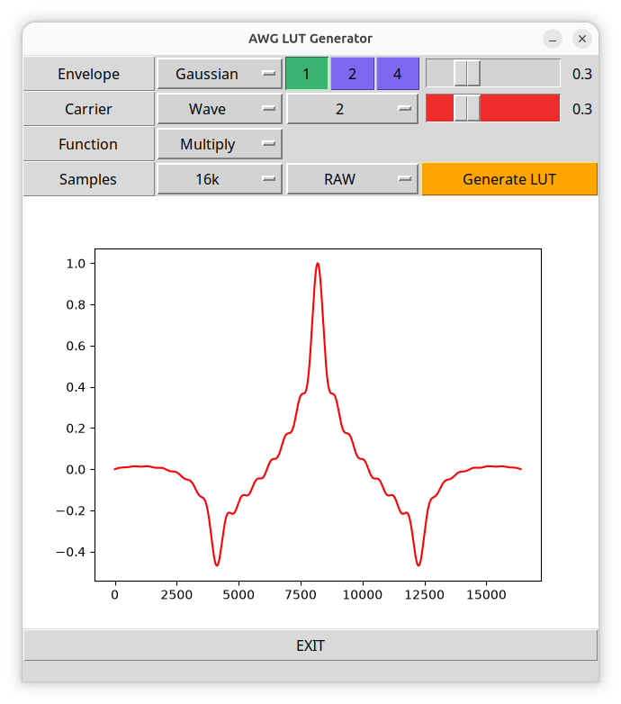
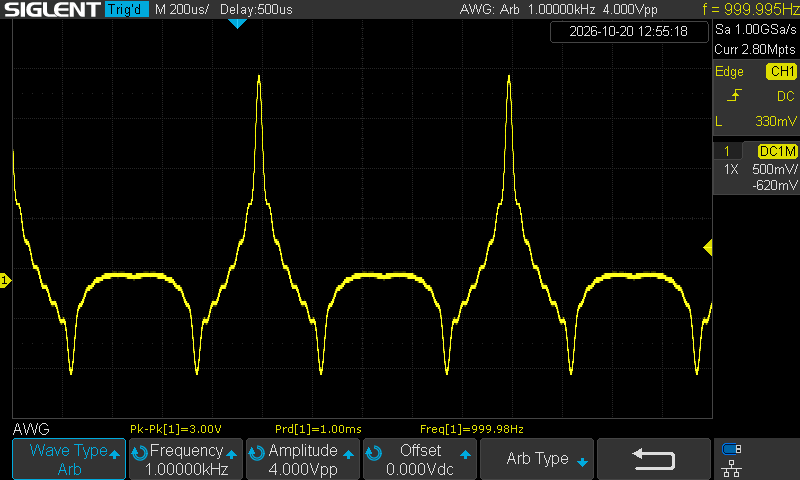

# AWG LUT Generator

A desktop application for generating arbitrary waveform generator (AWG) lookup tables. It combines a Tkinter interface, NumPy signal processing, Matplotlib waveform previews, and CSV export. Device-specific CSV headers can be supplied as templates.

The application **generates CSV files**; it does not communicate with an AWG over USB, SCPI, or another instrument interface.

## Features

- Waveforms: **Sine**, **Square**, **Gaussian**, **Exponential**, and **Wave** (harmonic series).
- Independent envelope and carrier selection, with configurable repetition counts and shape parameters.
- **Multiply**, **Add**, and **Subtract** operations.
- Preview of the resulting waveform in the GUI.
- Sample counts from **1k to 64k** for manual selection.
- **RAW** CSV export or device-specific export using `headers/Header_<device>.csv` templates.
- Automatic sample-count selection when a device header declares `data length`; the sample-count control is disabled while that header is selected. Returning to RAW restores the previous manual selection.

## Requirements

- **Python 3.10 or newer** (the application uses `match` statements and modern type annotations).
- NumPy and Matplotlib, installed from `requirements.txt`.
- Tkinter. On Ubuntu, install the system package if it is missing:

  ```bash
  sudo apt install python3-tk
  ```

## Installation

Clone the repository, then create a virtual environment in the project directory:

```bash
git clone <repository-url>
cd awg-lut-generator
python3 -m venv .venv
source .venv/bin/activate
python -m pip install -r requirements.txt
```

Replace `<repository-url>` with the actual repository URL. On Windows, use the appropriate virtual-environment activation command for your shell.

## Run

```bash
python main.py
```

In the GUI, choose an envelope and/or carrier, configure their parameters, and select an operation when both signals are enabled. Choose the sample count and output format, inspect the preview, then click **Generate LUT** to export the CSV file.

The application starts with both waveform selectors set to **None**. Select at least one waveform to enable export.

## Signal processing

- **Gaussian** and **Exponential** waveforms are min-max normalized to `[0, 1]`.
- The combined signal is normalized by its maximum absolute sample value, preserving polarity. An all-zero signal remains zero.
- Established waveform sampling conventions are preserved for compatibility, including the inclusive endpoint used by `np.linspace` where applicable.

## CSV export

Exported files are placed in a directory named after the selected format, relative to the **current working directory**:

```text
RAW/<generated-filename>.csv
SAG1021/<generated-filename>.csv
```

Each waveform sample is written with a **one-based index** and **six digits after the decimal point**. Device-specific exports prepend the corresponding CSV header template. The existing header serialization is preserved for instrument compatibility.

For example, `headers/Header_SAG1021.csv` declares `data length,16384`, so selecting **SAG1021** fixes the output at **16,384 samples**. RAW export allows manual selection.

## Hardware validation

The screenshots below compare the waveform preview generated by the application with the signal observed on a Siglent oscilloscope after loading the exported lookup table into the AWG.

| **Application preview (NumPy / Matplotlib):** | **Measured AWG output (Siglent oscilloscope):** |
|:---:|:---:|
|  |  |

The oscilloscope trace reproduces the characteristic central peak, side minima, and smaller oscillations visible in the software preview. The capture shows multiple periods of the repeating output, whereas the application preview displays the lookup-table samples. This is a visual hardware check, not a sample-by-sample amplitude or timing accuracy measurement.

## Project structure

```text
main.py                  Application entry point
core/
  waveforms.py           Waveform generation and sample-count options
  modulation.py          Waveform combination and normalization
gui/
  main_window.py         Tkinter UI and Matplotlib preview
services/
  csv_export.py          Header discovery and CSV export
headers/
  Header_SAG1021.csv     SAG1021 header template
requirements.txt         Python dependencies
README.md                Project documentation
docs/img/             Application and oscilloscope captures
```

## Tests and benchmarks

The development branch `tests_and_benchmarks` contains the test suite and performance benchmark. After switching to that branch, run:

```bash
python -m unittest discover -s tests -v
python benchmarks/benchmark.py
```

The tests cover waveform generation, modulation, combinations, and CSV export. Benchmarks measure generation, modulation, and export timings at several sample counts. Timing results depend on the machine and Python environment.

> During the repository cleanup, the `tests/` and `benchmarks/` directories may still be present on `main` until the planned branch split is completed.
